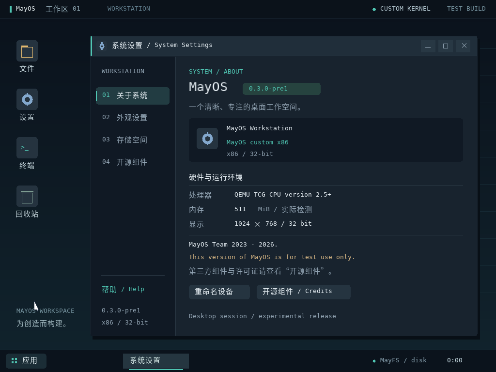

# MayOS 0.3.0-pre1 — BIOS / UEFI 双内核工作台

> **当前仓库状态（2026-11-01）：** 本目录源代码已经加入 Ubuntu 风格窗口、真实 Fastfetch 的 Linux 模式集成以及 XRGB8888 图形刷新优化；这些新提交尚未打包成经过验证的新 ISO。原先发行包仍是历史 0.3.0-pre1 测试构建。早期 `MayOS_0.1_Eng` 和 `MayOS_0.2_Eng` 已从工作树删除，可从 Git 提交历史查看。见 [版本说明](docs/repository-lineage.md)。

> 源码、文档及许可通知保存在仓库；请到 [GitHub Releases](https://github.com/ZhongYeMay/MayOS/releases) 核对**实际存在**的附件，不要假设新版本已经发布。新版网页源码见 [website/](../website/)。

MayOS 是实验性的双启动桌面操作系统原型。自研 MayKernel 为 x86 32 位；独立 Linux 图形模式为 x86_64。GRUB 负责 BIOS / UEFI x64 引导。最新源码的图形界面采用 Ubuntu 风格的深紫灰底色、橙色重点色、简洁顶栏、应用 Dock 和克制的窗口控件。

**MayOS Team 2023 - 2026.**

**This version of MayOS is for test use only.**

官网与每次更新发布地址：<https://mayos-official.business-tea-9633.chatgpt.site/>

| 启动项 | 实际运行环境 | 文件保存方式 |
| --- | --- | --- |
| MayOS — custom kernel (desktop) | 自研 x86 32 位内核与桌面 | MayFS 专用 IDE 数据盘；支持冷启动读回 |
| Linux 7.3.1 — desktop (x86_64) | Linux 内核上的真实 `mayos-desktop` 用户态进程 | 桌面进程内 RAM 文件区；进程退出后清空 |
| Linux 7.3.1 — rescue shell (x86_64) | BusyBox 文本救援环境 | Linux 临时根文件系统；关机后清空 |

Linux 图形模式同时保留串口 BusyBox shell。桌面的 RAM 文件区和 shell 的 Linux 根文件系统是两个独立空间。Linux 默认不挂载、不格式化、不写入 MayFS；尚未实现跨内核共享文件。

本次固定内核为 **Linux 7.3.1**，对应 kernel.org 于 **2026-10-30** 发布、在 **2026-11-01** 查询到的最新稳定版。版本、源码与产物 SHA-256 见 `build/linux/manifest.json`；启动后可用 `uname -r` 或图形终端 `fastfetch`（新源码 Linux 模式） 核对。后续执行 `make linux-update` 获取新的稳定版后，需要重新验证。



## 2026-11-01 源码开发更新（尚未提供新版 ISO）

- 为 Linux x86_64 模式加入真实 Fastfetch 可执行文件打包流程及系统信息窗、命令行集成。
- 桌面改为更专业、减少卡通感的 Ubuntu 风格深紫灰/橙色界面。
- Linux framebuffer 对原生 XRGB8888 颜色布局使用逐行拷贝的优化路径，其余支持布局维持通用像素转换。
- 增加 `website/` 网站源文件，提供网站持续更新和部署工作流。
- 以上是**仓库源码状态**；下面的旧版发行记录、测试与录屏不等同于新源码的正式验证。

## 本版变化（历史 0.3.0-pre1 发布记录）

- 同一 ISO 包含 GRUB `i386-pc` BIOS 与 `x86_64-efi` 启动程序；标准 EFI 回退路径为 `EFI/BOOT/BOOTX64.EFI`。
- 自研内核采用 Multiboot 内存映射，避开 UEFI 保留内存；修复只根据连续低地址内存统计导致的可用内存误报。
- Linux 图形后端使用 fbdev、evdev、Linux 时钟与系统信息，静态链接 musl；保留独立救援项与失败时的明确错误回退。
- “关于”展示版本、当前真实内核和两句指定声明；“开源组件”列出 Linux、GNU GRUB、BusyBox、musl、字体以及 QEMU / OVMF 的用途与许可。
- 保留文件管理、编辑器、MayShell、主题切换、窗口操作、应用搜索和猫咪彩蛋。
- 历史官网提供原 0.3.0-pre1 测试包与录屏；本轮新代码尚未制作对应镜像和录屏。

UEFI x64 指固件和 EFI 引导程序架构；**MayKernel 本身仍为 32 位**。Linux 内核和 Linux 桌面为 x86_64。本次没有启用 Secure Boot。

## 运行发布包

解压主发布包，进入 `mayos` 目录。建议使用 QEMU x86_64、512 MiB 内存、标准 VGA、PS/2 和 IDE。运行现成镜像不需要下载 Linux 源码或编译依赖。

### BIOS

```sh
qemu-system-x86_64 -machine pc -accel tcg -cpu max -m 512 -vga std \
  -cdrom build/mayos-dual.iso \
  -drive file=build/mayos-disk.img,format=raw,if=ide,index=0 \
  -boot d -serial stdio -no-reboot
```

使用 ↑ / ↓ 选择，Enter 确认。5 秒后默认启动自研桌面。数据盘必须位于 IDE primary master；启动 ISO 位于光驱。

### UEFI x64 / OVMF

以下为 Ubuntu 24.04 的 OVMF 路径；其他环境按实际安装位置调整。初次运行时为虚拟机复制 VARS 模板，以后复用该副本。

```sh
test -f build/mayos-uefi-vars.fd || \
  cp /usr/share/OVMF/OVMF_VARS_4M.fd build/mayos-uefi-vars.fd
qemu-system-x86_64 -machine pc -accel tcg -cpu max -m 512 -vga std \
  -drive if=pflash,format=raw,readonly=on,file=/usr/share/OVMF/OVMF_CODE_4M.fd \
  -drive if=pflash,format=raw,file=build/mayos-uefi-vars.fd \
  -cdrom build/mayos-dual.iso \
  -drive file=build/mayos-disk.img,format=raw,if=ide,index=0 \
  -boot d -serial stdio -no-reboot
```

安装构建工具后也可运行 `make run-uefi`，通过 `OVMF_CODE` / `OVMF_VARS` 覆盖固件模板路径。CODE 始终只读，每个测试或录屏虚拟机使用独立 VARS 副本。

`build/mayos.iso` 为仅包含自研内核的 BIOS / UEFI 混合镜像。无数据盘时，MayKernel 可使用内存文件系统；已有未知格式数据不会被自动覆写。随附 `build/mayos-disk.img` 保留上传版本的原始内容。

### Linux 串口与救援终端

图形终端中的 MayShell 支持 `help`、`fastfetch`、`ls`、`write`、`cat`、`memtest` 等内建命令。它不是 Linux shell；完整 BusyBox shell 可通过上述 QEMU 的串口标准输入输出使用，或选择第三个救援启动项。

```sh
uname -r
cat /run/mayos-desktop.pid
cat /proc/$(cat /run/mayos-desktop.pid)/comm
cat /run/mayos-desktop.log
echo hello > /tmp/hello.txt
cat /tmp/hello.txt
poweroff -f
```

`reboot -f` 请求重启；带 `-no-reboot` 的 QEMU 会退出，移除该参数可在虚拟机中重新进入引导菜单。图形初始化失败时，系统记录原因并回退到 tty1 shell。

## 从源码构建

Debian / Ubuntu 示例依赖：

```sh
sudo apt-get install build-essential gcc-multilib \
  grub-pc-bin grub-efi-amd64-bin grub-common xorriso mtools dosfstools \
  qemu-system-x86 ovmf ffmpeg python3 python3-pil \
  fonts-noto-cjk fonts-dejavu-core flex bison bc libelf-dev libssl-dev \
  xz-utils busybox-static musl-tools rsync
make
make dual
make run-uefi
```

使用 x86_64、Python 3.12+ 环境。`make` 构建自研混合 ISO；`make dual` 校验并复用已有 Linux 产物，缺少时编译。首次 Linux 编译需要额外时间与磁盘空间。仅需 BIOS 构建可指定 `BOOT_FIRMWARE=bios`；默认是 `hybrid`。

```sh
# 显式升级稳定版，之后重新生成和验证镜像
make linux-update LINUX_JOBS=4
make dual
make test-dual
make test-uefi

# 固定本次版本
make linux LINUX_VERSION=7.3.1 LINUX_JOBS=4
make dual LINUX_VERSION=7.3.1

# 将匹配源码放回 build/linux/downloads/ 后离线重建
python3 scripts/linux.py build --version 7.3.1 --offline --rebuild --jobs 4
```

`BUSYBOX=/path/to/static/busybox` 可指定静态 x86_64 BusyBox；`MAYOS_LINUX_CC` 可指定 musl 编译器；`MAYOS_FONT` 可指定 Noto CJK 字体。已解包工具链可使用 `MAYOS_TOOL_ROOT` 与 `scripts/local-env.sh`。实际配置、源码 SHA-256、输入哈希、桌面和内核产物哈希均保存在 Linux manifest 中；修改共享 GUI 会使缓存失效并重建桌面。

`make clean` 保留数据盘、Linux 源码与构建缓存、验证记录，只清理自研内核及 ISO 等可重建输出。更换自己的数据盘前应关闭虚拟机并备份现有文件。

## 桌面操作

- 左侧图标启动文件管理器、设置、终端等应用；左下角“应用”或 Win 键打开菜单并搜索。
- 标题栏拖动窗口，右侧按钮依次最小化、最大化/恢复、关闭；底部任务按钮恢复窗口。
- 文件列表双击或 Enter 打开；右键菜单提供复制、剪切、重命名、回收站与属性。Backspace 返回上级，Delete 移入回收站；回收站内 Delete 永久删除。
- 编辑器支持文末输入、退格与 Ctrl+S 保存，关闭未保存文件时提示。
- F1 打开 MayShell；↑ 调用上一条命令，↓ 清空；Esc 关闭菜单或弹层。
- “设置 → 关于系统”显示当前内核、处理器、内存和测试声明；“开源组件”展示第三方说明。

```text
fastfetch
memtest
mkdir Projects
write Projects/hello.txt Hello from MayOS
cat Projects/hello.txt
cd Projects
pwd
mv hello.txt notes.txt
rm notes.txt
save
```

`write` 将路径后的剩余文本写入文件；`mv` 当前只重命名；`rm` 移入回收站。MayShell 不支持引号或含空格路径。

## 实际测试与录屏

```sh
make test
make test-dual
make test-uefi

python3 scripts/record_boot.py --firmware uefi --kernel custom \
  --ovmf-code /usr/share/OVMF/OVMF_CODE_4M.fd \
  --ovmf-vars /usr/share/OVMF/OVMF_VARS_4M.fd --output MayKernel-UEFI.mp4
python3 scripts/record_boot.py --firmware uefi --kernel linux \
  --ovmf-code /usr/share/OVMF/OVMF_CODE_4M.fd \
  --ovmf-vars /usr/share/OVMF/OVMF_VARS_4M.fd --output Linux-UEFI.mp4
```

QMP 测试操作真实 PS/2 键鼠，检查客体串口、文件内容、冷启动读回与整个数据盘哈希。BIOS 与 UEFI 报告都绑定同一个最终 ISO SHA-256。Linux 模式额外核对 `/sys/firmware/efi`（UEFI）、`/dev/fb0`、真实桌面进程、鼠标编辑与 Ctrl+S、串口 shell 重生和关机。

录屏从启动前开始连续采样真实 QEMU framebuffer，包含固件、GRUB、桌面、“关于”、开源组件、 `fastfetch`（新版源码）与文件写入读回；以 1024×768、10 fps 的 H.264 MP4 输出。无音轨。每个视频旁的 JSON 记录 ISO 和视频哈希、时间、帧数及固件哈希。详见 [验证记录](docs/validation.md)。

## 当前边界

实际验证范围为 QEMU 8.2.2 TCG、x86 PC、BIOS / OVMF x64 UEFI、标准 VGA、PS/2、IDE 和 512 MiB 内存。未验证 Secure Boot、实体硬件安装、ARM / Apple Silicon 原生启动或任意 GPU。

自研模式要求 1024×768×32 RGB framebuffer。内存显示来自可用内存映射，物理页分配器目前最多管理前 128 MiB，并跳过保留区；内存显示值与分配器管理上限是不同指标。自研应用仍在同一内核地址空间，没有用户态隔离、分页、SMP、通用异常处理、可执行文件加载、网络栈、USB 或音频支持。

Linux 模式运行真实用户态桌面，但桌面应用仍共用一个进程，尚无完整发行版包管理器、独立应用沙箱或持久化桌面用户目录。桌面 RAM 文件和 shell rootfs 均为临时空间；不代表已兼容全部 Linux 应用或硬件驱动。

MayFS / 桌面文件模型最多 48 个目录项，文件名 47 字节，每文件 4095 字节。自研盘只使用前 256 KiB，当前只挂载一块专用 IDE 数据盘。保存使用校验头，但无日志、双副本或断电恢复工具。中文为字体子集显示，美式 ASCII 键盘输入，无中文输入法。主题与设备名仅在当前会话有效。编辑器尚无任意光标定位与滚动。

## 发布文件与开源说明

| 文件 | 内容 |
| --- | --- |
| `MayOS-0.3.0-pre1.zip` | MayOS 完整源码、BIOS / UEFI 双内核与自研 ISO、数据盘、Linux/桌面/BusyBox 产物、许可、测试报告、录屏元数据 |
| `MayOS-0.3.0-pre1-third-party-sources.zip` | Linux、BusyBox、musl、GRUB 对应完整源码与补丁、配置、构建脚本及许可 |
| `MayOS-0.3.0-pre1-UEFI-MayKernel.mp4` | 最终 ISO 的 UEFI 自研内核启动与桌面实录 |
| `MayOS-0.3.0-pre1-UEFI-Linux.mp4` | 同一 ISO 的 UEFI Linux 图形桌面启动与操作实录 |
| `MayOS-0.3.0-pre1-SHA256SUMS.txt` | 发布包、对应源码、两个视频及双启动 ISO 的 SHA-256 |

第三方版本和许可见 [组件说明](docs/third-party/dual-boot.md)。完整许可文本位于 `docs/third-party/`、`build/linux/licenses/`，Linux 客体内也有 `/usr/share/licenses/`。QEMU / OVMF 为外部运行与测试工具，没有嵌入启动 ISO。MayOS 自研代码沿用现有授权，没有在本次更新中重新授权。

发布脚本会检查 BIOS / UEFI 报告、两份录屏元数据与当前 ISO 一致，并检查对应源码和 Linux 桌面产物。每次完成更新按 [发布约定](docs/release-policy.md) 同步官网。

## 源码导航与彩蛋

`kernel/` 包含启动、核心、MayFS 与共享 GUI；`linux/desktop.c` 为 Linux 显示输入后端；`linux/desktop-session` 管理桌面启动与回退；`scripts/linux.py` 构建 Linux 和静态桌面；`scripts/dual_iso.py` 打包 BIOS / EFI 混合 ISO；`scripts/*smoke.py` 验证实际启动；`scripts/record_boot.py` 录制真实帧；[架构文档](docs/architecture.md) 记录内部结构。

终端输入 `meow`，或在“关于”连续点击设备图标 5 次可显示原猫咪照片；Esc、Enter、返回或关闭退出。官网也保留五击标识与输入 `meow` 的入口。照片来自 `assets/easter-cat.jpg`，构建时生成等比例 RGB565 资源；无需网络。
